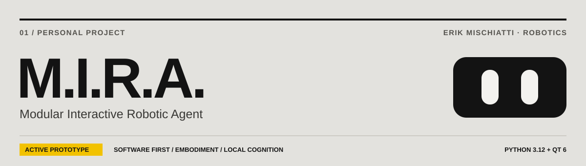
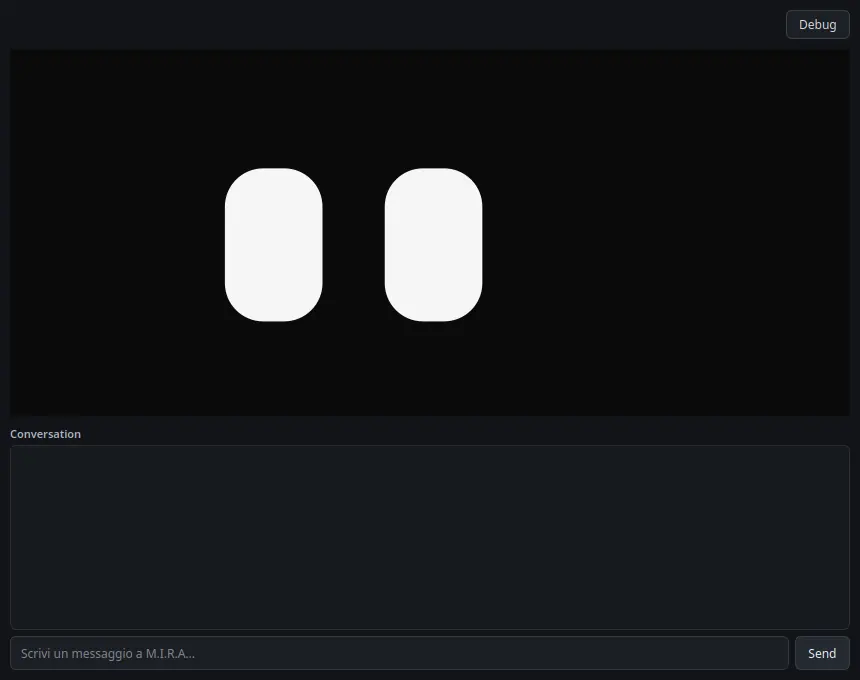
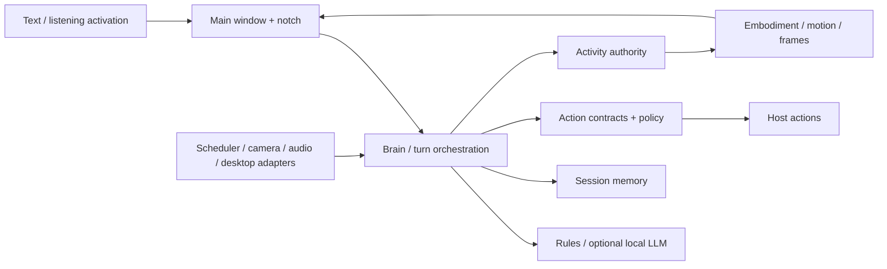

# M.I.R.A.

**An embodied assistant, built software first.**

M.I.R.A. explores how an assistant perceives, responds and expresses itself before it has a physical body. Expressive eyes, a compact conversation window and an ambient notch share one modular runtime. The current implementation is a desktop prototype built with Python and PySide6, with a technology-independent core intended to support future robotic embodiment.

[Portfolio & demos](https://erikmischiatti.com/pages/mira_page.html) · [Setup](#getting-started) · [Architecture](docs/architecture.md) · [Configuration](docs/configuration.md) · [Development](docs/development.md)

[](https://github.com/ErikMischiatti/M.I.R.A/actions/workflows/ci.yml)
[](LICENSE)

## 01 / Two surfaces, one assistant

<table>
<tr>
<td width="65%" valign="top">

<br><strong>Main window</strong><br>
Animated face, text interaction, action feedback and an optional debug drawer.
</td>
<td width="35%" valign="top">

<br><strong>Ambient notch</strong><br>
Compact eyes at the top of the selected screen. Expansion reveals notices, controls, a countdown timer or the listening waveform. Double-click opens the main window.
</td>
</tr>
</table>

*Images are frames from the project's offscreen portfolio demos, not photographs of a physical robot. The portfolio contains earlier branch-status descriptions; the feature status below reflects this repository.*

`mira` and `mira-notch` join the same runtime per user on each operating system. `mira-tune` is a separate preview and configuration tool. Both application surfaces share one embodiment clock, so opening another view does not duplicate the assistant or speed up its animations.

## 02 / Implemented today

| Area | Current implementation |
|---|---|
| Embodiment | Renderer-independent frames, expressive eyes, blink, gaze, idle movement, thinking/speaking motion and semantic feedback cues. |
| Cognition | Italian rule-based intents; optional local Ollama inference with validated output, confidence gates and rule fallback. |
| Safe actions | Explicit registry, contracts and execution policy. Stale asynchronous results cannot execute actions. Requests requiring confirmation are blocked until a confirmation flow exists. |
| Session context | Bounded in-session memory and contextual prompts. No persistent personal memory. |
| Ambient interaction | Notch transitions, notice priority, task feedback, device information and countdown timer. Linux device/connectivity producers are optional and platform-specific. |
| Audio input | Keyboard activation, optional local wake-word detection, voice-activity detection and utterance segmentation. Speech transcription is not implemented. |
| Nonverbal voice | Optional offline synthesized vocalizations, with configurable identity and two synthesis engines. This is expressive sound, not spoken replies. |
| Perception | Optional threaded camera capture, person observations, stabilized human presence and diagnostics. No identity recognition or perception-driven gaze yet. |
| Native desktop adapters | Linux and Windows runtime election/IPC, host-specific application/folder actions, monitor selection and Qt DPI handling. Optional Windows per-window desktop pinning. |

Long-running inference stays off the UI thread. Memory, actions, events and visible state are finalized in one serialized context after checking that the result still belongs to the current request.

## 03 / Getting started

Requires **Python 3.12**. The default engine is rule-based; Ollama, a camera and voice models are optional.

### Linux

```bash
git clone https://github.com/ErikMischiatti/M.I.R.A.git
cd M.I.R.A
python3.12 -m venv venv
venv/bin/python -m pip install --requirement requirements.txt
source venv/bin/activate

mira              # main window
mira-notch        # ambient notch, same application runtime
mira-tune         # standalone tuning and previews
```

The repository's `./bin/mira`, `./bin/mira-notch` and `./bin/mira-tune` launchers also work without activating the environment. See [system libraries and PATH setup](docs/development.md).

### Native Windows — PowerShell

```powershell
git clone https://github.com/ErikMischiatti/M.I.R.A.git
cd M.I.R.A
py -3.12 -m venv .venv
.\.venv\Scripts\python.exe -m pip install -c constraints.txt -e ".[dev,windows]"

.\.venv\Scripts\mira.exe
.\.venv\Scripts\mira-notch.exe
.\.venv\Scripts\mira-tune.exe
```

The `bin\mira*.cmd` launchers use the repository's native Windows environment. Native Windows runs Qt directly against Windows monitors and scaling; a Linux process launched inside WSL uses the WSLg bridge instead. Choose the native runtime for Windows desktop integration. [Windows setup and limitations](docs/development.md#native-windows-python-312)

### Optional features

| Feature | Install / enable |
|---|---|
| Local LLM | Run Ollama locally; set `MIRA_INTENT_ENGINE=llm`. The rule engine remains the fallback. |
| Camera + presence | Install the `camera` extra; set `MIRA_CAMERA=1` and optionally `MIRA_PERSON_DETECTION=1`. |
| Wake-word activation | Install the `voice` extra, supply the documented local models and configure listening. Keyboard activation remains available. |
| Expressive sound | Set `MIRA_VOICE=1`; configure its engine, pitch and volume through the documented environment variables. |
| Windows desktops | The `windows` extra supplies the pinning adapter. It targets the notch only and degrades safely if the Windows shell API is unavailable. |

All environment variables, model locations, hardware checks and platform-specific capabilities are described in [configuration](docs/configuration.md) and [development](docs/development.md). Linux/X11 workspace requests do not control Windows virtual desktops through WSLg. Wayland placement is compositor-controlled; macOS workspace pinning is not implemented.

## 04 / Architecture



The domain, memory and messaging layers are independent of Qt. Technology bindings live in adapters; the application composition root owns the shared graph and shutdown sequence. One activity authority commits visible state. Camera frames and perception results use a pull-based data plane rather than flooding the semantic event bus.

[Full architecture](docs/architecture.md) · [Module boundaries and contributor rules](mira/AGENTS.md)

## 05 / Validation & scope

GitHub Actions validates **Python 3.12 on Linux and native Windows**. Linux runs the full suite; Windows runs native locking/named-pipe integration, startup/shutdown, Qt scheduler and portable cognitive/domain contracts. Both jobs compile the package and check layering and state authority.

```bash
python -m compileall -q mira
python scripts/check_layering.py
python scripts/check_state_authority.py
QT_QPA_PLATFORM=offscreen python -m pytest   # Linux full regression
```

Camera and microphone tests use doubles, and LLM tests do not need a real Ollama server. Visible GUI behavior, real devices, mixed-DPI monitor changes and virtual-desktop behavior need separate acceptance checks. Native Windows DPI, placement and per-window pinning have also been exercised on a real desktop; this does not guarantee compatibility with every Windows shell version.

**Next milestones:** portable desktop adapters, speech transcription, explicit action-confirmation UI, persistent memory and perception-driven attention. Physical robot integration remains a future stage. Historical identity experiments and validation branches are preserved separately; their functionality is not claimed as integrated.

## 06 / Project notes

Created by **[Erik Mischiatti](https://erikmischiatti.com/)** as a personal, software-first robotics project. README presentation and demo imagery draw on the [portfolio case study](https://erikmischiatti.com/pages/mira_page.html); implementation and validation claims are grounded in this repository.

| Document | Purpose |
|---|---|
| [Development](docs/development.md) | Environments, lowercase launchers, tests, platform limitations and hardware acceptance. |
| [Configuration](docs/configuration.md) | Runtime options, optional subsystems and feature flags. |
| [Architecture](docs/architecture.md) | Responsibilities, interfaces and dependency direction. |
| [Consolidation report](docs/consolidation.md) | Branch reconciliation, integration history, preservation and recovery. |

Licensed under [MIT](LICENSE).
