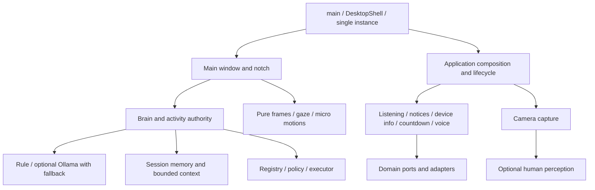
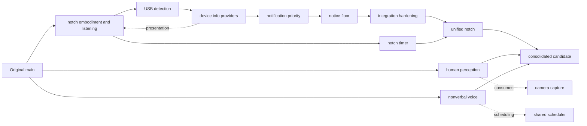

# Repository consolidation — 2026-11-24

## Executive summary

A clean but old main coexisted with a large desktop feature stack and separate
voice/perception work. Three history-preserving integrations combine the mature
optional services without redesigning the inner architecture. Historical WIP,
demo assets and the identity experiment remain preserved and explicitly named.
Cleanup and publication await a single owner decision.

## Initial state and preservation

Original main: `5be4131762d55012250027812b0e649386468ba9`, synchronized with origin/main after fetch without pruning. Four local branches, twenty remote branch tips (plus symbolic origin/HEAD), one clean main worktree, no stashes or tags. No tracked modifications or untracked source files. Ignored virtual environments, caches and local configuration were left untouched. All local branch commits were reachable on remote main; two local upstream names no longer exist.

The verified complete bundle and original ref mapping are in `.mira-recovery/` in the original checkout (ignored, never publish). The bundle was cloned into a bare repository and passed `git fsck --full`; dangling objects in that clone are bundled remote tips, not corruption. Recover any original tip using `git fetch /absolute/path/to/original.bundle <original-ref>:refs/heads/recovery/<name>`. Never overwrite existing branches.

## Branch reconciliation

Remote rows below use `origin/`; local rows retain their exact names. Recovery is the original full SHA in the bundle and `refs.txt`. Counts and patch equivalence are in `branch-inventory.json`.

| Original branch | Purpose / unique functionality | Classification and action | Recovery tip |
|---|---|---|---|
| `ftr/llm_async_integration` | Use LLM response text in response builder | DELETE CANDIDATE: already in original main | `c0d855bce3c8f9fda40ac54962f13ea6226ba55a` |
| `main` | Canonical desktop/camera baseline | Stable baseline; integration descends from this tip | `5be4131762d55012250027812b0e649386468ba9` |
| `refactor/embodiment-frame` | refactor: introduce renderer-independent embodiment frame | DELETE CANDIDATE: already in original main | `4c63bb195592f2efe4ceb725a8310c29bc1e9dc3` |
| `refactor/embodiment-vocabulary` | refactor: separate embodiment activity and affect vocabulary | DELETE CANDIDATE: already in original main | `060a929f1e7ce64598ff0536f57bf8c586f57b65` |
| `origin/assets/voice-demos` | Generated voice demo WAVs and ZIP assets | ARCHIVE: preserve distributable demos separately; runtime synthesis already integrated | `40944445d9ac5f407418695f29b926c82a3c2b5d` |
| `origin/backup/stash-llm-session-context` | Stashed session context and permissive JSON extraction | KEEP SEPARATE: historical safety backup; modern bounded context supersedes part, permissive parser remains unique and needs security review | `7f3b350afe8647e57903c12bef2c1bb0e408c186` |
| `origin/feat/device-info-providers` | docs: document device information providers and their manual checks | MERGE: preserved through unified notch, perception or voice merge; deletion candidate after approval | `84ec4d53af4089a71fd2ccc909fa81d809060904` |
| `origin/feat/embodiment-micro-motions` | docs: update embodiment micro-motion architecture | DELETE CANDIDATE: already in original main | `3bc91307379a24f0a4975b2d030451332e190a0d` |
| `origin/feat/nonverbal_voice` | feat(voice): add nonverbal synthesis with V2 presets | MERGE: preserved through unified notch, perception or voice merge; deletion candidate after approval | `460055f243506172cd4fd7d588991e47605f0769` |
| `origin/feat/notch-embodiment-ui` | docs: document voice activation and utterance segmentation | MERGE: preserved through unified notch, perception or voice merge; deletion candidate after approval | `48d1ac649b43e82291993f600e1b2e125eb9262e` |
| `origin/feat/notch-notification-priority` | docs: document notice priority, the name and detail layout, and MIRA-TUNE scenarios | MERGE: preserved through unified notch, perception or voice merge; deletion candidate after approval | `2f3d1a3be0d51bfc8e3f7ecc39436f5fc17d0e24` |
| `origin/feat/notch-timer` | docs: document the notch countdown timer | MERGE: preserved through unified notch, perception or voice merge; deletion candidate after approval | `102e832a655729efe18ea72753b9929f46147657` |
| `origin/feat/perception-camera-foundation` | docs: document camera perception foundation | DELETE CANDIDATE: already in original main | `54ea3ee6008f13a0e189ed776a430c3373cc8657` |
| `origin/feat/perception-human-presence` | docs: document human presence perception | MERGE: preserved through unified notch, perception or voice merge; deletion candidate after approval | `98a7b49690de489ec9a090db5fd3190e4c918078` |
| `origin/feat/usb-device-detection` | docs: document USB mode switching, recovery and the hardware checklist | MERGE: preserved through unified notch, perception or voice merge; deletion candidate after approval | `0bec65998f912efb48c85d64a6e9b8bf3ba42a14` |
| `origin/fix/notch-integration-hardening` | docs: document band owners, notice expiration, SIGTERM shutdown and query cancellation | MERGE: preserved through unified notch, perception or voice merge; deletion candidate after approval | `e5c8dda8fed799606cdba544273d1431b47bb381` |
| `origin/fix/notch-notice-floor` | docs: describe turns and band owners in notice priority | MERGE: preserved through unified notch, perception or voice merge; deletion candidate after approval | `5940ec4abbfb4b389cc7547289a355e18f104973` |
| `origin/ftr/cognitive_layer_stabilization` | Confidence gates, fallback diagnostics, bounded context, user name memory and identity responses | KEEP SEPARATE: gates/context overlap main functionally; name/identity behavior is unique and requires porting away from old core models and UI FaceState imports; no wholesale merge | `d8f888975d5483e64a4f205df0ec02ccac4e803e` |
| `origin/integration/notch-unified` | docs: describe the unified notch, its integration lineage and acceptance testing | MERGE: preserved through unified notch, perception or voice merge; deletion candidate after approval | `8b37018fc785a79c7ec2195ed7eab6c7b97a03e8` |
| `origin/main` | Canonical desktop/camera baseline | Stable baseline; integration descends from this tip | `5be4131762d55012250027812b0e649386468ba9` |
| `origin/refactor/embodiment-frame` | refactor: introduce renderer-independent embodiment frame | DELETE CANDIDATE: already in original main | `4c63bb195592f2efe4ceb725a8310c29bc1e9dc3` |
| `origin/validate/m3-timer-integration` | WIP timer integration and additional priority tests | ARCHIVE: superseded runtime by unified notch; preserve unique validation tests for future differential review | `ddbe3dcffc100a0b0026f39ab20c76358e0eaf58` |
| `origin/validate/m41-integration-candidate` | WIP timer integration and additional priority tests | ARCHIVE: superseded runtime by unified notch; preserve unique validation tests for future differential review | `a35a5df782458f6a6520df08ebde16b3f07c0b44` |

## Integration and architecture

Integration order: unified notch (includes USB, providers, notice priority, timer and shutdown hardening), independent optional human perception, independent optional nonverbal synthesis. Full feature histories are retained with merge commits. No cherry-picks or published history rewrites. Text conflicts in composition, optional extras, fixtures and documentation were reconciled to retain both sides. Capture stays in `qt_audio.py`; synthesis output lives in `qt_voice_output.py` with a compatibility export. Perception stops before camera, voice and all timer users stop before scheduler.

Qt remains at adapters, UI and entry point. Domain, memory and messaging remain independent. Camera frames and detections are pulled, never broadcast on the event bus. Person detection and synthesized voice are disabled by default. Voice activation models remain optional; no new packages or model files were installed. Speech segmentation is implemented; speech transcription and conversational speech output are not. Presence is a stabilized observation, not identity recognition or an automatic action trigger.

## Remaining work and roadmap

1. Run hardware acceptance checks in development.md: microphone, camera, audio output, USB mode changes, X11 workspace behavior, real Ollama and visible resizing.
2. Port the cognitive branch user-name and identity behavior with current domain models and memory ownership; add stale-async-result regression tests before enabling it. Retain its original history.
3. Review permissive backup JSON extraction against strict schema and action policy before selective reuse.
4. Review unique validation-branch timer tests against unified acceptance coverage; keep original WIP branches until that comparison is complete.
5. Add transcription behind the existing voice ports, then explicit action confirmation UI; persistence and robotic adapters follow only after lifecycle contracts are stable.

## Publication and cleanup

No branch is deleted automatically. Preserve backup/stash, assets and validation refs. After approval, delete only ancestor-proven integrated feature refs and the three obsolete local branches using `git branch -d`; remote deletion uses explicit `git push origin --delete <name>`. Publish main with ordinary `git push origin main:main` only after checking remote has not advanced. No force push. Keep integration worktree until explicitly authorized to remove it.

## Dependency graph

Solid arrows below are Git ancestry; dashed arrows are runtime dependencies.

## Validation and final state

Baseline: 602 passed, 1 skipped, 7 subtests passed (12.25 s). The provided
virtual environments both use Python 3.14.4; the supported Python 3.12 CI
environment was not available locally. No environment packages were installed.
Initial sandboxed notch run: 1961 passed, 67 failed, 6 skipped; local sockets
were denied. A permitted combined run was interrupted after 1939 passed,
4 failed and 6 skipped: one obsolete constructor test (fixed), one missing
Qt Multimedia native library (explicit dependency skip; CI now installs
libpulse0), two cross-checkout subprocess import errors (validation now sets
PYTHONPATH to the integration tree). No production assertions were weakened.
Focused composition/lifecycle/voice/perception: 96 passed. Cross-feature
shutdown/default-disabled hardware and audio adapter: 5 passed, 1 skipped.
Qt scheduler independently: 14 passed. Both architecture checkers, compileall,
pip check and whitespace validation pass. Final full suite: **2306 passed, 9 skipped, 7 subtests passed in 131.87 s**.
The run used offscreen Qt, socket permission and explicit integration PYTHONPATH. Visible GUI, real Ollama, webcam, microphone, audible
output and USB hardware acceptance remain manual.

Original main remains checked out in its original worktree, so it has not been
modified behind that worktree. The integration branch contains the candidate.
Remote refs are unchanged. No push, deletion, stash mutation, reset, or existing
worktree removal has occurred. Preservation aliases are `archive/voice-demos`,
`archive/llm-session-context`, `archive/validate-m3-timer`,
`archive/validate-m41-candidate`; `exp/cognitive-identity-port` names the retained
cognitive work. All original tips remain recoverable. See
[exact approval operations](consolidation-approval.md).

## Final verification and remaining limitations

Every original branch tip is retained both by its original ref and the verified
bundle. No unique work has been discarded. The cognitive identity port, backup
parser and unique validation tests remain explicit follow-up work. Existing
worktrees and ignored personal files were not removed or modified.

The runtime still has no persistent memory, general speech transcription,
physical robot integration or confirmed action execution UI. Optional presence
detection uses OpenCV cascade observations and needs real-world accuracy checks.
The default app remains rule-based; camera, person detection and synthesized
voice are opt-in. Existing wake-word optional dependency declarations were
preserved without installing their packages.

The original checkout has only the intentionally created ignored-on-candidate
`.mira-recovery/` directory as new local preservation data; on the old main it
will appear untracked until the candidate `.gitignore` is adopted.

## Integration checkpoints

- `8003017`: merge unified notch and desktop services.
- `db345d2`: merge optional human presence; reconcile service lifecycle,
  environment isolation, camera extras and diagnostic UI.
- `c7ffa19`: merge nonverbal synthesis; separate capture/playback adapters,
  retain existing subscriptions and optional voice configuration.
- Final follow-up commit: current-interface perception test, cross-feature
  lifecycle tests, explicit unavailable Multimedia test skip, Linux CI native
  audio prerequisite, documentation and exact cleanup plan.

No selective source integration was required. Cognitive functionality is
retained separately rather than partially ported without full behavioral tests.
